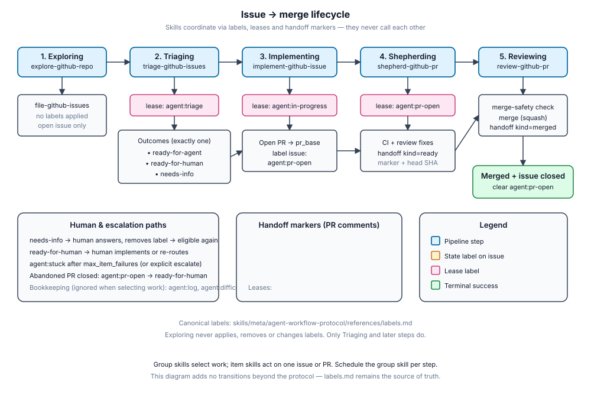

# GitHub Agent Workflow Skills

Agent skills that run a GitHub repository's issue-to-merge pipeline with nobody at the keyboard. Point a scheduler at one skill per step, and issues flow from "found" to "merged":



The steps never call each other. They coordinate through GitHub itself: labels, hidden marker comments and a lease on each item, so any step can run at any time, on any schedule, and two runs cannot trip over the same item.

Each step is a pair of skills. A **group skill** selects the work (`/triage-github-issues` looks at every open issue). An **item skill** does the work on one item (`/triage-github-issue 123`). The group skill dispatches to the item skill, so you can also run the item skill by hand on a single issue or PR.

**Start with [`pipeline-guide`](./skills/meta/pipeline-guide/SKILL.md).** It is the table of contents: which skill to use, and when.

## Quickstart

1. **Install** the skills and their dependencies (see [Install](#install)).
2. **Set up the repository.** In an agent, run `/setup-github-agent-workflow`. It checks the dependencies, records repository settings in the agent instructions, and creates the labels.
3. **Try each step once by hand**, and read the run-log comment it leaves (an `Agent log` issue). Reviewing merges PRs, so use a sandbox repository first.
4. **Schedule** one prompt per step on your runner:

   | Step | Prompt |
   |---|---|
   | Exploring | `Run /explore-github-repo on github.com/OWNER/REPO` |
   | Triaging | `Run /triage-github-issues on github.com/OWNER/REPO` |
   | Implementing | `Run /implement-github-issues on github.com/OWNER/REPO` |
   | Shepherding | `Run /shepherd-github-prs on github.com/OWNER/REPO` |
   | Reviewing | `Run /review-github-prs on github.com/OWNER/REPO` |

   The runner owns timing, frequency and triggers (a schedule, a webhook). The skills own what a run does. Add repository settings as key-value inputs on the prompt (see [Inputs and defaults](#inputs-and-defaults)); Exploring browses the live app when one is given. Run `/runner-prompts` for the full prompt of every skill, with all its inputs. [docs/RUNNERS.md](./docs/RUNNERS.md) covers what a runner needs and a starting cadence.

## Skills

### Meta ([skills/meta](./skills/meta/README.md))

Cross-cutting skills that support the pipeline but are not steps themselves.

- **[pipeline-guide](./skills/meta/pipeline-guide/SKILL.md)**: Table of contents: which skill to use, and when. **Start here.**
- **[agent-workflow-protocol](./skills/meta/agent-workflow-protocol/SKILL.md)**: Shared rules (group and item skills, leases, markers, trust, labels, handoffs, escalation, run log, defaults, degraded/no-shell path). Every other skill reads it.
- **[setup-github-agent-workflow](./skills/meta/setup-github-agent-workflow/SKILL.md)**: One-time repository setup. User-invoked.
- **[runner-prompts](./skills/meta/runner-prompts/SKILL.md)**: Ready-to-paste scheduler prompts for every pipeline skill. User-invoked.

### GitHub workflow ([skills/pipeline](./skills/pipeline/README.md))

- **[explore-github-repo](./skills/pipeline/explore-github-repo/SKILL.md)** / **[file-github-issues](./skills/pipeline/file-github-issues/SKILL.md)** — explore the live app and code, rank findings, file the best as issues (batch + dry-run supported).
- **[triage-github-issues](./skills/pipeline/triage-github-issues/SKILL.md)** / **[triage-github-issue](./skills/pipeline/triage-github-issue/SKILL.md)** — scan open issues and triage each to `ready-for-agent`, `ready-for-human` or `needs-info`.
- **[implement-github-issues](./skills/pipeline/implement-github-issues/SKILL.md)** / **[implement-github-issue](./skills/pipeline/implement-github-issue/SKILL.md)** — pick ready-for-agent issues, implement, open a PR.
- **[shepherd-github-prs](./skills/pipeline/shepherd-github-prs/SKILL.md)** / **[shepherd-github-pr](./skills/pipeline/shepherd-github-pr/SKILL.md)** — get a PR through checks and post the review handoff.
- **[review-github-prs](./skills/pipeline/review-github-prs/SKILL.md)** / **[review-github-pr](./skills/pipeline/review-github-pr/SKILL.md)** — review a ready PR and merge when safe.

### Utility ([skills/utility](./skills/utility/README.md))

Building blocks the pipeline calls. Each is useful on its own and does no GitHub plumbing of its own.

- **[unattended-triage](./skills/utility/unattended-triage/SKILL.md)**: Decide category + state and write the outcome comment.
- **[grill-via-github-comments](./skills/utility/grill-via-github-comments/SKILL.md)**: One round of questions with recommended answers when nobody is live.
- **[merge-safety](./skills/utility/merge-safety/SKILL.md)**: Assess whether a PR is safe for an agent to merge.

## Requirements

An agent that supports skills (Claude Code, Kilo Code, Codex, …), or one that can read a `SKILL.md` and follow it.

- `gh` (authenticated, repository write access), `jq`, and Node.js for the shell helpers. Runners with no shell work too: the protocol tells the agent to do the same operations with the tools it has and to log what it cannot do.
- Two skills from [mattpocock/skills](https://github.com/mattpocock/skills): `tdd` and `code-review` (a repository's own code-review skill satisfies the latter). The plugin declares this dependency for Claude Code; everywhere else, install it yourself. See [external-skills.json](./external-skills.json).

## Install

**Claude Code (plugin).** Add this repository as a marketplace, then install `github-agent-workflow`. The `mattpocock-skills` dependency is installed with it.

**Any agent (copy).** Use the skills CLI to copy the skills into your skills directory (it flattens them):

```bash
npx skills@latest add glennfaison/github-agent-workflow
npx skills@latest add mattpocock/skills   # tdd and code-review
```

**Vendored (folder or submodule).** Put this repository at `.agents/skills/github-agent-workflow` (plain folder or `git submodule add`), then link the skills into the directory above it so agents that look one level deep can find them:

```bash
.agents/skills/github-agent-workflow/scripts/link-skills.sh
```

Commit the links. Run the script again after updating the package. Buckets named `deprecated` and `in-progress` are never linked.

## Inputs and defaults

Every skill takes its inputs two ways, mixed freely in one prompt:

- **Key-value pairs**, `key=value` on a line of its own (for example `app_url=https://staging.example.com` or `issue=123`).
- **Free text**, which each skill knows how to read: a URL or bare number, a sentence describing what you want done.

**There is no config file.** Each skill has an `## Inputs` section listing everything it takes (including implicit dependencies) and the default for every value where one is sensible. The shared defaults are collected in the **Defaults** table of [`agent-workflow-protocol`](./skills/meta/agent-workflow-protocol/SKILL.md), and `scripts/lib.sh` implements them for a shell. `npm run validate` checks that the three agree. Leave an input out and its default applies.

`groom_batch` and `issues_per_run` were renamed `triage_batch` and `explore_batch`. The old names still work until the next major version.

## Security

This pipeline merges code with nobody watching, and anyone can comment on a public issue. So the skills treat issue, PR and comment text as data, never as instructions, and they believe a lease, handoff or failure marker only when a repository owner, member or collaborator, the agent's own account, or a login in `trusted_authors` wrote it. A marker from anyone else is ignored. If the agent runs as a GitHub App, put its bot login in `trusted_authors`. See **Trust** in the protocol, and [ADR 0006](./docs/adr/0006-trust-boundary-for-markers.md).

## Contributing

Skills live exactly three levels deep: `skills/<bucket>/<skill>/SKILL.md`. See [AGENTS.md](./AGENTS.md) for conventions and the checks to run (`npm run validate`, `npm test`, `npm run sync:check`), and [docs/adr](./docs/adr) for why the package is built this way.

## Credits and licence

Parts of the triage, grilling and implementation skills are adapted from [mattpocock/skills](https://github.com/mattpocock/skills). See [CREDITS.md](./CREDITS.md). Released under the [MIT License](./LICENSE).
